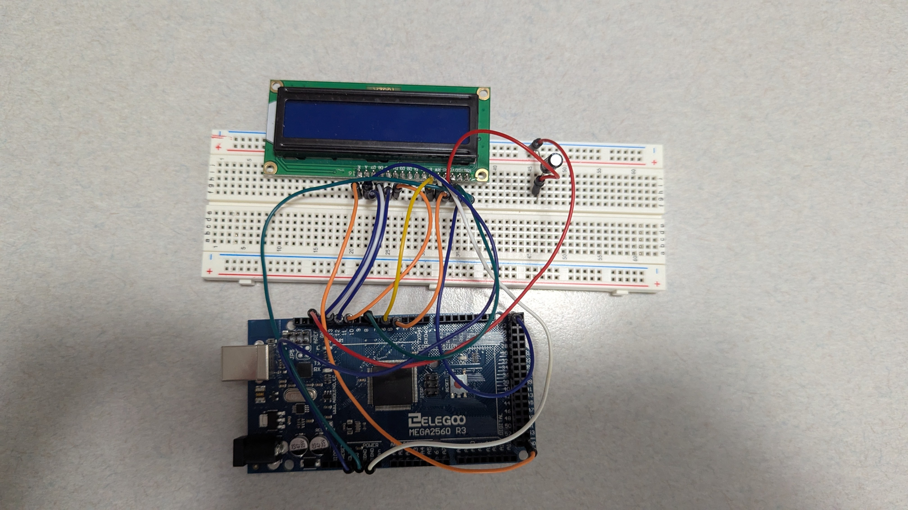

# FA26-IT254 Individual AI Model Project - Owen McGrath

An AI model project that recognizes whether a smartphone or a graphing calculator is shown to my laptop webcam and displays the result on a physical LCD screen controlled by an Arduino.

## How it works

Webcam → Teachable Machine model code in MS Visual Studio Code → USB serial → Arduino Mega 2560 → LCD 1602

Python script classifies webcam frames using a Google Teachable Machine model and sends a short message ("none, "smartphone", or "calculator) to the Arduino over USB. The Arduino shows the result on the LCD.

## Demo

[Demo video](DemoVideo.mp4)

## Wiring (LCD to Arduino)

1. VSS -> GND
2. VDD -> 5V
3. V0 -> Pin 7 and capacitor to GND
4. RS -> Pin 4
5. RW -> GND
6. E -> Pin 5
7. D4 -> Pin 10
8. D5 -> Pin 11
9. D6 -> Pin 12
10. D7 -> Pin 13
11. A -> 5V
12. K -> GND
